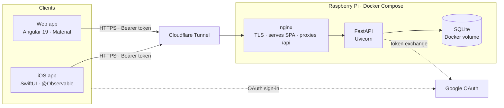

<div align="center">

# WeekBite

**Weekly meal planning for you and your family: native iOS app, Angular web app and a self-hosted Python backend.**

Plan your meals for the week, keep a shared recipe collection and build the shopping list straight from the ingredients.

[](https://github.com/severingoddon/WeekBite/actions/workflows/backend-tests.yml)


</div>

---

## About

WeekBite answers the daily question of what to cook. You keep a personal collection of menus, assign them to the days of the week, and turn ingredients into a shopping list with one tap. Families share their week plan and shopping list, and everyone can use the recipes of every member.

There are two clients with the same features: a **native SwiftUI app** for iPhone and an **Angular web app**. Both use one **FastAPI backend** that runs in Docker on a Raspberry Pi at home and is reachable through a Cloudflare Tunnel.

The UI is in German. Code, comments and docs are in English.

## Features

### Week plan
- **Seven-day planner** that creates the current week automatically
- **Menu picker** with search and sorting by effort. You can add ingredients to the shopping list directly from the picker.
- **Plan ahead or look back:** create next week in advance or open any past week with a date picker
- **Reset a week** with one action, after a confirmation prompt

### Menus
- A personal **recipe collection** with title, ingredients, effort in minutes, notes and a link to the original recipe. Links are clickable.
- **CSV import and export** of the menu collection in the web app. The import validates the structure and gives clear error messages.

### Shopping list
- Add items by hand or **from a menu's ingredients**
- Duplicates are detected **without regard to case**
- Tick off items while shopping, or clear the whole list

### Families
- **Create a family and invite members by email.** Invitees see the invitation and can accept or decline it.
- A **context switcher** toggles between *Private* and any of your families. The week plan and shopping list follow the active context.
- In a family context, **all members' menus** are available, labeled with their owner.
- Only the creator can rename or delete a family and remove members. Members can leave at any time.

## Architecture



### Engineering highlights

| Area | Approach |
|---|---|
| **Two clients, one API** | The SwiftUI and Angular clients have the same features and use the same REST API. The iOS app has no third-party dependencies (MVVM with `@Observable`, async/await). |
| **Context model** | Each week and shopping item belongs either to a user or to a family. The active context is stored on the server, so it is the same on the phone and in the browser. |
| **Authorization** | Every request is checked for ownership or family membership. Menus stay personal. Family members can read and plan each other's menus but not edit them. |
| **Authentication** | Google OAuth. The backend issues an opaque session token. iOS uses `ASWebAuthenticationSession` with a custom URL scheme and stores the token in the **Keychain**. |
| **Access control** | Only verified Google accounts on an allowlist can sign in. The allowlist is seeded from the environment and can be managed by an admin through the API. A pending family invite also grants access. |
| **Data integrity** | SQLite foreign keys are enforced on every connection. Deleting a family or menu cascades cleanly, so a recycled ID never exposes old data. Regression tests cover this. |
| **Testing** | The backend has a pytest suite with an isolated in-memory database per test and a mocked OAuth round trip. It covers auth, allowlist and invites, family permissions, context isolation, weeks, menus and the shopping list. It runs on every push via GitHub Actions. |
| **Safe deployments** | The Ansible playbook backs up the database before every deploy. It refuses to run if the data volume is missing and checks the volume mount afterwards. It only touches this project's containers and images, because the Pi also runs other services. |
| **Configuration** | Secrets and host details live in gitignored files (`backend/.env`, `ansible/inventory.ini`). The repo only contains `*.example` templates. |

## Tech stack

| Layer | Technology |
|---|---|
| **iOS** | Swift, SwiftUI, Observation, Keychain Services, XcodeGen |
| **Web** | Angular 19, Angular Material, TypeScript, SCSS |
| **Backend** | Python 3.12, FastAPI, SQLAlchemy 2, Pydantic 2, Authlib |
| **Database** | SQLite on a persistent Docker volume |
| **Infrastructure** | Docker Compose (multi-stage builds), nginx, Cloudflare Tunnel, Raspberry Pi |
| **CI / Deployment** | GitHub Actions, Ansible |

## Project structure

```
WeekBite/
├── SwiftApp/
│   ├── project.yml              # XcodeGen project definition
│   └── WeekBite/
│       ├── Auth/                # OAuth session and Keychain storage
│       ├── Network/             # API client, endpoints, errors
│       ├── Models/              # Codable API models
│       ├── ViewModels/          # @Observable view models
│       ├── Views/               # Week plan, menus, shopping list, families
│       └── Theme/
├── frontend/                    # Angular web app (served by nginx)
│   └── src/app/
│       ├── components/          # Week plan, menus, shopping list, families
│       └── services/            # API client, auth guard and interceptor
├── backend/
│   ├── main.py                  # FastAPI app and routes
│   ├── models.py                # SQLAlchemy models
│   ├── schemas.py               # Pydantic schemas
│   ├── database.py
│   └── tests/                   # pytest suite
├── ansible/deploy.yml           # Deployment playbook
├── .github/workflows/           # CI: backend tests
├── docker-compose.yml
└── docs/                        # API reference and deployment guide
```

## Getting started

### Backend

```bash
cd backend
python3 -m venv venv
source venv/bin/activate
pip install -r requirements.txt
cp .env.example .env            # then fill in your values
uvicorn main:app --reload --port 8000
```

You need a Google OAuth client ([Google Cloud Console](https://console.cloud.google.com/apis/credentials)) with `http://localhost:8000/api/auth/google/callback` as an authorized redirect URI. Add your Google account to `ALLOWED_EMAILS` in `.env`.

Run the tests:

```bash
pip install -r requirements-dev.txt
pytest
```

### Web app

```bash
cd frontend
npm install
npx ng serve                    # http://localhost:4200, proxies /api to :8000
```

### iOS app

Requires Xcode 16+ and [XcodeGen](https://github.com/yonaskolb/XcodeGen).

```bash
brew install xcodegen
cd SwiftApp
xcodegen generate
open WeekBite.xcodeproj
```

1. Set `baseURL` in `SwiftApp/WeekBite/Network/APIEndpoints.swift` to your backend, e.g. `http://localhost:8000` for the simulator.
2. Select your development team under **Signing & Capabilities**. If you need to, change the bundle identifier in `project.yml`.
3. Build and run.

## Documentation

- [API reference](docs/API.md): all REST endpoints
- [Deployment guide](docs/DEPLOYMENT.md): Raspberry Pi, Docker Compose, Ansible, Cloudflare Tunnel, TLS

---

<div align="center">
Built by <a href="https://github.com/severingoddon">Severin Goddon</a>
</div>
